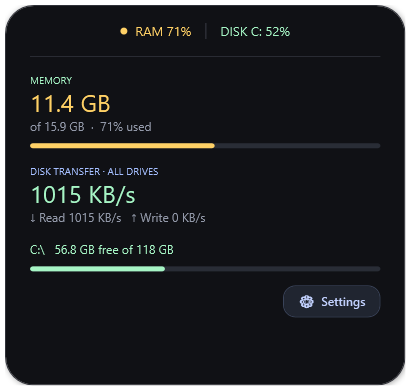
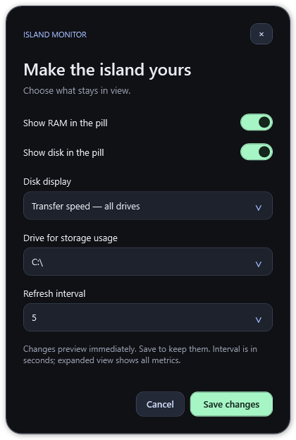

<p align="center">
  
</p>

# Island Monitor

A small, native Windows RAM and disk monitor inspired by the shape of Dynamic Island. Keep your system stats in a floating pill, expand for details, and manage it from the system tray.

[](https://github.com/fajraii/island-monitor/actions/workflows/windows.yml)
[](LICENSE)

<p align="center">
  
  
</p>

## Features

- Physical RAM usage, disk storage usage, and combined disk read/write speed.
- A draggable, always-on-top pill that fits one or both visible metrics.
- Expanded details and colors that follow current usage.
- Tray controls to show, hide, configure, or quit; no taskbar button for the widget.
- Dark settings with immediate preview, Save/Cancel, and persistent preferences.
- Standalone WPF executable with no browser, telemetry, or third-party runtime packages.

## Download and run

1. Download `IslandMonitor-X.Y.Z-windows.zip` from [Releases](https://github.com/fajraii/island-monitor/releases).
2. Extract the ZIP and run `IslandMonitor.exe`.
3. Click the pill to expand it. Drag to reposition. Right-click the pill or tray icon for settings and controls.

Requires Windows 10 or 11 and .NET Framework 4.x. Windows PowerShell 5.1 is needed only to build from source. Release binaries are unsigned, so Windows may show an unknown-publisher prompt. Administrator privileges are normally unnecessary. Windows ARM devices and older Windows versions have not been tested.

Windows may put the tray icon under the **^** hidden-icons arrow. Double-click it to show or hide the widget. Closing the widget hides it; choose **Quit Island Monitor** from its menu to stop the background process. The app does not register itself to start with Windows.

To verify a download, compare this result with the release's `SHA256SUMS.txt`:

```powershell
Get-FileHash .\IslandMonitor-0.1.0-windows.zip -Algorithm SHA256
```

## Configure

Open **Settings** from the expanded pill or **Settings…** from its right-click or tray menu.

| Setting | Behavior |
| --- | --- |
| Show RAM / Show disk | Either metric or both; at least one must remain enabled |
| Disk display | Selected-drive storage used (%) or combined transfer speed across all physical drives |
| Drive | Drive used for storage percentage and free-space details |
| Refresh interval | Update every 1, 2, 5, or 10 seconds |

Changes preview immediately and resize the collapsed pill around its center. **Save changes** keeps your choices; **Cancel** or closing settings restores them. Expanded view shows all metrics regardless of the pill selection.

| Color | Threshold |
| --- | --- |
| Green | Below 70% |
| Yellow | 70–89% |
| Red | 90% or higher |
| Gray | Reading unavailable or warming up |

RAM colors follow physical memory used. Storage colors follow the displayed drive usage percentage. Transfer colors follow measured disk active time across all physical drives, not an arbitrary MB/s limit. Thresholds are fixed in this release. Hover a metric for an explanation.

## Build and test

Run in Windows PowerShell from a checkout:

```powershell
.\build.ps1
powershell -NoProfile -STA -ExecutionPolicy Bypass -File .\tests\smoke.ps1
.\bin\IslandMonitor.exe
```

If script execution is restricted, invoke the build using `powershell -NoProfile -ExecutionPolicy Bypass -File .\build.ps1`. This applies only to that process. The build uses the compiler and WPF libraries shipped with .NET Framework. It generates icons and embeds the settings theme into `bin/IslandMonitor.exe`. No package restore or network access is required for the build. Quit the app before rebuilding the executable you are running.

Create a portable release ZIP and checksum:

```powershell
.\scripts\package.ps1
```

Builds go to `bin/`; packages go to `dist/`. Both directories are ignored by Git. See [CONTRIBUTING.md](CONTRIBUTING.md) for the source map, manual checks, and release process.

## Privacy and troubleshooting

The app makes no network requests and stores no monitoring history. Preferences are saved in `%LOCALAPPDATA%\IslandMonitor\settings.xml`. Quit the app and remove that file to reset settings. Delete the executable to uninstall; remove the preferences folder to clear saved choices.

- **Disk transfer unavailable:** Windows performance counters can be disabled, restricted, or absent. Storage usage works independently. The app does not change system counter settings.
- **Selected drive unavailable:** reconnect it or choose another drive in settings.
- **Hidden widget:** use the tray icon's Show / hide command; Return to top center is in the widget menu.
- **Build fails because the file is in use:** quit the app from the tray and retry.

## Contribute and license

Read [CONTRIBUTING.md](CONTRIBUTING.md), [report a bug or suggest a feature](https://github.com/fajraii/island-monitor/issues/new/choose), or submit a focused pull request. Report vulnerabilities privately as described in [SECURITY.md](SECURITY.md). Release history is in [CHANGELOG.md](CHANGELOG.md).

Copyright © 2026 fajraii. Source code and original logo assets are available under the [MIT license](LICENSE). Dynamic Island and iPhone are Apple trademarks; this independent project is not affiliated with or endorsed by Apple.
